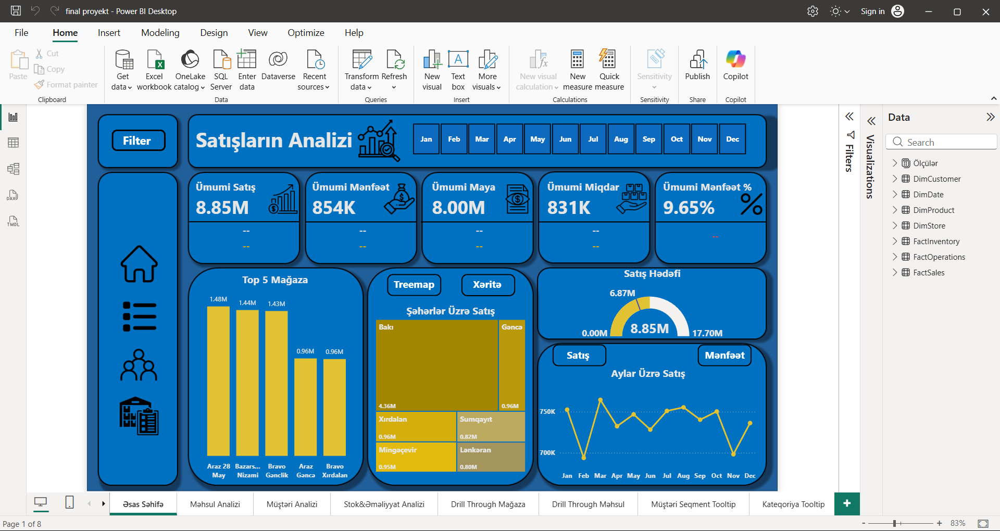

# Power BI Sales Analytics Dashboard

## 📊 Project Overview

This project presents an interactive sales analytics dashboard
developed using Microsoft Power BI.

The dashboard provides insights into sales performance,
profitability, inventory, and customer behavior.

## 🛠️ Tools & Technologies

- Microsoft Power BI
- DAX
- Power Query
- Data Modeling

## 📈 Key Metrics

- Total Sales
- Total Cost
- Total Quantity
- Previous Year Revenue
- Previous Month Profit %
- Inventory Value
- Repeat Customers
- Average Product Margin %

## 📷 Dashboard Preview

### Main Dashboard

